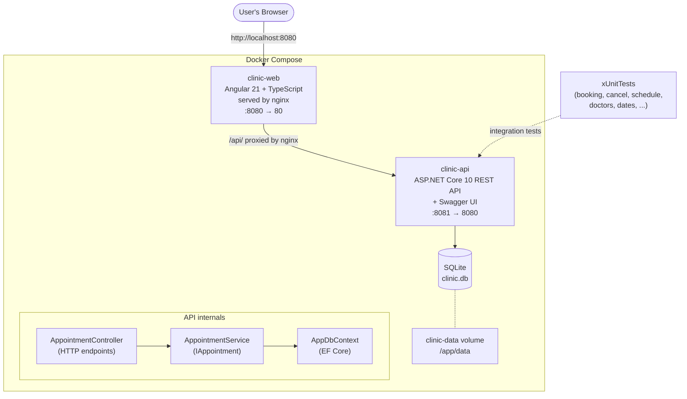

# Solution Diagram — ClinicAppointmentBooking

## Overview



## Compact view

```
 Browser (localhost:8080)
        │
        ▼
┌─────────────────────┐      /api/ proxy       ┌──────────────────────────────┐
│  clinic-web         │ ──────────────────────► │  clinic-api                  │
│  Angular 21 (TS)    │     nginx → api:8080    │  ASP.NET Core 10             │
│  • Book page        │                         │  AppointmentController       │
│  • Appointments pg  │                         │    → AppointmentService      │
└─────────────────────┘                         │    → AppDbContext (EF Core)  │
                                                └──────────────┬───────────────┘
                                                               ▼
                                                   SQLite clinic.db
                                                (clinic-data Docker volume)

  xUnitTests ──► integration tests against the API
```

## API endpoints (`AppointmentController`)

| Method   | Route                                        | Purpose                      |
| -------- | -------------------------------------------- | ---------------------------- |
| GET      | `/api/appointments/doctors`                  | List doctors                 |
| GET      | `/api/appointments/dates`                    | Available booking dates      |
| GET      | `/api/appointments/doctors/{id}/schedule`    | Time slots for a doctor/date |
| POST     | `/api/appointments/book`                     | Book an appointment          |
| GET      | `/api/appointments/patients/{id}/appointments` | Patient's appointments     |
| DELETE   | `/api/appointments/cancel`                   | Cancel an appointment        |

## Data model

```
Person (base)
 ├── Doctor
 └── Patient
Appointment  ──►  Doctor + Patient + date/time slot
```
